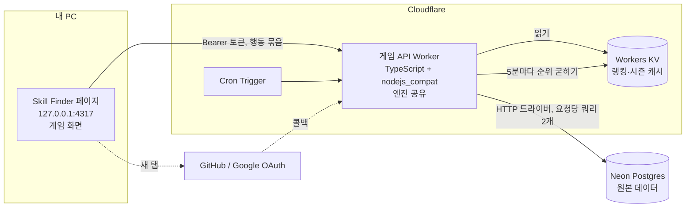
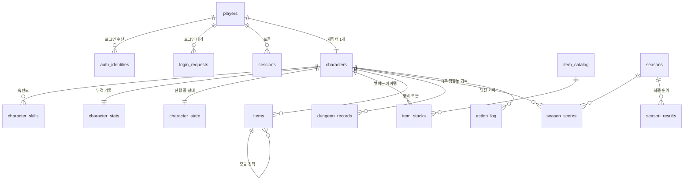

# ARASAKA_IN 온라인 DB·배포 설계

게임을 온라인에 배포해 **랭킹**을 만들고, 캐릭터·가방을 서버에 저장한다.

- 친구와 협력하거나 플레이어끼리 거래하는 기능은 없다. 다른 플레이어와 닿는 곳은 랭킹과 공개 프로필뿐이다.
- 게임 화면은 지금처럼 **로컬 Skill Finder(127.0.0.1) 안**에 두고, 외부 게임 API를 부른다.

DDL·함수: [`arasaka-schema.sql`](arasaka-schema.sql)
- PostgreSQL 15+ 기준이다.
- 메모리에서 도는 Postgres(PGlite)로 검증했다: 36개 규칙·함수 검사 통과.

## 0. 배포 구성



| 부분 | 쓰는 것 | 역할 |
|---|---|---|
| 백엔드 | Cloudflare Workers | 게임 API. Node.js 호환 모드(`nodejs_compat`)의 TypeScript다. 게임 엔진(`web/src/game/actions.ts`의 `applyActions`)을 그대로 import해 서버에서 돌린다 |
| 원본 DB | Neon(PostgreSQL) | 계정·캐릭터·가방·기록·시즌 점수. 모든 쓰기는 여기로 간다 |
| 캐시 | Workers KV | 랭킹 상위 목록, 현재 시즌 정보처럼 **모두가 읽고 자주 바뀌지 않는 값**만 둔다 |
| 예약 작업 | Cron Trigger | 랭킹을 KV에 굳히기, 시즌 마감, 만료 세션 청소 |

**KV에 게임 상태를 두지 않는 이유**
- KV는 다른 지역에 쓴 값이 보이기까지 최대 약 60초 걸린다.
- 같은 키에는 초당 1번만 쓸 수 있다.
- 그래서 매 턴 바뀌는 캐릭터 상태나, 즉시 반영돼야 하는 세션·정지 처리에는 맞지 않는다. 이런 것은 모두 Neon에 둔다.

**Neon 연결 방식**
- Worker에서 `@neondatabase/serverless`의 HTTP 드라이버를 쓴다.
- HTTP 쿼리 하나가 곧 트랜잭션 하나다. 그래서 여러 표를 한꺼번에 바꾸는 저장은 DB 함수(`apply_batch`) 한 번 호출로 처리한다.
- 요청 하나에 왕복은 두 번이다: 불러오기, 저장.
- Worker는 **Smart Placement**를 켜서 Neon 리전 가까이에서 실행되게 한다. 사용자 → Worker 구간은 한 번만 멀고, Worker ↔ DB 왕복 두 번은 짧아진다.
- Neon 리전은 한국에서 가까운 아시아 리전을 고른다.
- Neon은 한동안 요청이 없으면 컴퓨트가 잠든다. 그 뒤 첫 요청은 깨어나는 시간만큼 느리다.

### 0.1 만들어 둔 실제 리소스 (2026-10-27)

비밀값(DB 비밀번호가 든 연결 문자열)은 여기에도 git에도 두지 않는다.

| 무엇 | 값 |
|---|---|
| Neon 프로젝트 | `skill-finder` (`quiet-surf-05937801`), 조직 `A`(무료), `aws-ap-southeast-1`(싱가포르), PostgreSQL 18 |
| Neon DB / 역할 | `skill_finder` / `skill_finder_owner`. `arasaka-schema.sql` 적용 완료(테이블 16개, 함수 5개) |
| Cloudflare 계정 | `54360923120c2364db8c053f0279a8ac` |
| Workers KV | `skill_finder` (`cdd1dae00c1f4c76a2fb13f49d847a4b`), 게임 API Worker에서 `RANK`로 연결 |
| 게임 API Worker | `skill-finder-api`, 코드는 `game-api/`. `https://skill-finder-api.a01075011775.workers.dev` (매일 18:00 UTC 정리 작업) |
| 소개 페이지 Worker | `skill-finder`, 정적 파일만(`site/`). `https://skill-finder.a01075011775.workers.dev` — Windows 다운로드(zip) 포함 |
| `DATABASE_URL` | 로컬: `game-api/.dev.vars`(git 제외). 배포본: Cloudflare 비밀값으로 등록됨(`wrangler secret list`로 이름만 확인 가능) |

- 이름 변경(2026-10-27): 처음 만든 `arasaka-in`(Neon 프로젝트), DB `arasaka`·역할 `arasaka_owner`, Worker `arasaka-in-api`는 비어 있는 상태에서 위 이름으로 바꾸거나 새로 만든 뒤 지웠다.
- 주소 가운데 `a01075011775`는 Cloudflare 계정의 workers.dev 하위 주소다. 바꾸려면 대시보드(Workers & Pages → 설정)에서 바꾼다. 모든 Worker 주소가 같이 바뀐다.
- 연결 문자열 다시 받기: `npx neonctl connection-string --project-id quiet-surf-05937801 --database-name skill_finder --role-name skill_finder_owner --pooled`
- 로컬 실행: `cd game-api && npm run dev` → `http://127.0.0.1:8787/v1/health`가 `{"kv":true,"db":true}`면 연결 정상이다.
- 게임 API 배포: `cd game-api && npm run deploy`. 상태 확인은 `https://skill-finder-api.a01075011775.workers.dev/v1/health`.
- 소개 페이지 배포: 루트에서 `npm run package`(zip을 `site/public/download/`로 복사) → `cd site && npx wrangler@4 deploy`.

## 1. 누가 상태를 계산하나: 서버만

랭킹이 있으면 조작이 문제다. 브라우저가 계산한 결과(레벨·크레딧)를 올리게 하면, 개발자 도구로 `level: 60`을 보내는 것만으로 1등이 된다.

- 브라우저는 **행동**만 보낸다. 예: `move east`, `attack special`, `print cache:weapon:rare`.
- Worker가 엔진을 돌려 결과를 저장하고, 새 상태를 돌려준다.
- 무작위는 DB에 있는 PRNG 상태(`character_state.rng_state`, uint32 4개, 엔진의 `GameState.rng`)로만 굴린다. 새로 고침해도 전리품을 다시 굴릴 수 없다.
  - 브라우저로 보낼 때는 `publicState()`로 PRNG를 지운다. 그래서 다음 결과를 미리 계산할 수 없다.
- 시간(방치 보상, 09시 초기화, 회복, 던전 기록)은 서버 시계로만 잰다.
- 그래서 v2 엔진은 **결정적**이어야 한다.
  - 모든 무작위는 인자로 받은 `rng`, 모든 시간은 인자로 받은 `now`만 쓴다.
  - 브라우저 전용 API(`localStorage`, `window`)를 쓰지 않는다.
- 던전 한 칸마다 요청을 보내면 느리다. 행동을 **묶어서** 보낸다(이동 여러 칸, 또는 전투 한 턴).
  - 브라우저는 같은 엔진으로 결과를 미리 그려 즉시 반응한다.
  - 서버 응답이 오면 그 상태로 맞춘다.
  - 결과를 보여 주기 전에 무작위가 필요한 행동(전투 피해, 상자 열기)은 응답을 기다린다.

## 2. 표 구성



| 표 | 담는 것 | 왜 이렇게 |
|---|---|---|
| `players` | 계정, 표시 이름, 시간대, 상태(정상·숨김·정지) | 이름은 대소문자 무시 고유(2~16자, 한글·영문·숫자·_). 랭킹에 나오는 이름이다 |
| `auth_identities` | GitHub·Google 로그인 연결 | 비밀번호를 저장하지 않는다. 한 계정에 여러 로그인 수단을 붙일 수 있다 |
| `login_requests` | 로컬 페이지가 시작한 로그인 한 건 | 5장 참고. 쿠키나 팝업 연결 없이 로그인한다 |
| `sessions` | 로그인 토큰 | 토큰 원문이 아니라 SHA-256만 저장한다. DB가 새어도 세션을 훔칠 수 없다. 30일 유효 |
| `characters` | 레벨, 경험치, 누적 경험치, 크레딧, 체력, 해금 구역, 가방 크기, 단축칸(Q·W·E), 플랫라인·오버클럭 시각, 마지막 레이드 날 | 랭킹과 프로필이 읽는 값이라 열로 둔다. `version`으로 동시 요청 충돌을 막는다 |
| `character_skills` | 인쇄·의료·탄약 숙련도 | 숙련도가 늘어나도(예: 채집) 표 구조를 바꾸지 않는다 |
| `character_stats` | 처치·보스·사망·던전·레이드·상자·인쇄·ICE 횟수 | 프로필과 시즌 점수의 근거 |
| `character_state` | 던전 진행, 전투, 길거리 적, 열린 대화, 퀘스트, 버프, 일감, 블랙마켓·무기고 재고, PRNG | 엔진만 읽고, 다른 플레이어와 비교하지 않는다. 구조가 자주 바뀌므로 JSON이다 |
| `item_catalog` | 쌓이는 아이템 종류(탄약·재료·회복제·상자·열쇠 조각) | 코드 오타를 외래 키로 막는다 |
| `item_stacks` | 캐릭터별 개수 | 0이 되면 행을 지운다. 최대 개수는 서버가 확인한다 |
| `items` | 장비·모듈 한 개당 한 행: 슬롯·등급·레벨·주 수치·부가 능력치·모듈 칸·장착 위치 | 같은 이름이어도 수치가 달라 낱개로 저장한다. id는 엔진이 만드는 UUID라서, 같은 묶음 안에서 새로 얻은 장비에 바로 모듈을 끼울 수 있다. 슬롯마다 하나만 장착되게 부분 고유 인덱스를 둔다 |
| `dungeon_records` | 던전별(구역·번호·도전 여부) 클리어 수, 최단 기록 | 던전 최단 기록 랭킹. 시간은 서버가 잰다(입장 → 보물방 정리) |
| `seasons`, `season_scores` | 주간 시즌과 보드별 점수 | 매주 초기화되는 랭킹. 새로 온 사람도 경쟁할 수 있다 |
| `season_results` | 시즌이 끝날 때 굳힌 최종 순위 | 나중에 정지·탈퇴가 있어도 지난 결과가 바뀌지 않는다 |
| `action_log` | 저장된 행동 묶음과 결과 상태의 해시 | 신고가 오면 처음부터 다시 돌려 검증한다. 30일 지나면 지운다 |

**가방**은 두 표를 합친 것이다.
- `items`: 가방 칸을 차지하는 낱개
- `item_stacks`: 칸을 차지하지 않는 묶음

가방 칸 수는 `items` 중 장착하지 않았고 장비에 끼우지 않은 행의 수다. 이 값이 `bag_capacity`를 넘으면 엔진이 획득을 거부한다.

## 3. 랭킹

| 보드 | 기간 | 점수 | 출처 |
|---|---|---|---|
| 레벨 | 전체 | 누적 경험치(같으면 먼저 도달한 사람) | `characters.total_xp`, `total_xp_at` |
| 주간 경험치 | 시즌 | 이번 주에 얻은 경험치 | `season_scores` `xp` |
| 주간 던전 | 시즌 | 보물방까지 정리한 던전 수 | `season_scores` `clears` |
| 주간 레이드 | 시즌 | 레이드 승리 수 | `season_scores` `raid` |
| 던전 최단 기록 | 전체 | 던전 15개 × 일반·도전, 가장 짧은 시간 | `dungeon_records.best_ms` |

**KV에 굳힌 상위 목록**
- Cron Trigger가 5분마다 Neon에서 보드별 상위 100명을 읽는다. 그 결과를 KV 키 두 개에 통째로 쓴다.
  - `rank:v1:boards`: 레벨·주간 3개 보드
  - `rank:v1:dungeons`: 던전 30개 최단 기록
- 쓰기는 하루 576번이다. KV 무료 한도(하루 쓰기 1,000번)에 들어간다. 주기를 1분으로 줄이려면 유료 플랜이 필요하다.
- 랭킹 화면은 KV만 읽는다. 플레이어가 아무리 많이 열어도 Neon에 부담이 없다.
- 현재 시즌 정보는 `season:v1:current`에 둔다. 시즌이 바뀔 때만 쓴다.

**내 순위는 실시간**
- 나보다 점수가 높은 행의 수 + 1이다. 인덱스 범위 계산이라 플레이어 수십만 명까지 바로 나온다.

  ```sql
  select 1 + count(*) from characters
  where ranked and (total_xp > $1 or (total_xp = $1 and total_xp_at < $2));
  ```

**정지·숨김**
- `players.status`를 바꾸면 같은 트랜잭션에서 `characters.ranked = false`로 바꾼다.
- 인덱스에서 빠지므로 다음 굳히기(5분 안)에 KV 랭킹에서도 사라진다.

**시즌 마감**
- `ends_at`이 지나면 Cron이 보드별 상위 1000명을 `season_results`에 복사한다. 그 뒤 다음 시즌 행을 만든다.

## 4. 행동 요청 한 번에 DB가 하는 일

`POST /v1/actions` · 헤더 `Authorization: Bearer <토큰>` · 본문 `{ version, actions: [...] }`

1. **불러오기**: `select load_character(sha256(토큰))`
   - 세션 확인과 캐릭터 전체 불러오기를 쿼리 하나로 한다(캐릭터, 상태, 숙련도, 기록, 장비, 묶음).
   - 토큰이 틀렸거나 만료됐거나 정지된 계정이면 `NULL`이 온다. 이때 401을 돌려준다.
2. **계산**: 받은 `version`이 불러온 값과 다르면 바로 409를 돌려준다. 같으면 엔진에 PRNG 상태와 서버 시각을 넣고 행동을 순서대로 적용한다.
   - 규칙에 어긋나는 행동은 거기서 멈추고 오류를 돌려준다. 예: 적이 남았는데 문으로 이동.
3. **저장**: `select apply_batch(character_id, version, 바뀐 부분)`
   - 캐릭터·상태·누적 기록·숙련도·장비 추가/수정/삭제·묶음 개수·던전 기록·시즌 점수·행동 기록을 **한 트랜잭션에서** 쓴다.
   - 그사이 다른 요청(다른 탭)이 먼저 저장했으면 아무것도 쓰지 않는다. 오류 코드 `AR409`가 나고, Worker는 409를 돌려준다. 브라우저는 최신 상태를 다시 받는다.
   - 묶음 안에서 장비를 바꿔 끼워도(A 해제 + B 장착) 슬롯 고유 규칙에 걸리지 않게 처리한다.

**나머지 규칙**
- 요청 제한은 Workers Rate Limiting 바인딩으로 건다: 플레이어당 초당 10묶음, 묶음당 행동 30개. KV는 쓰기 제한 때문에 제한 계산에 쓰지 않는다.
- 방치 보상과 체력 회복은 다음 요청 때 저장된 시각(`job.ends_at`, `hp_at`)으로 계산한다. 서버가 주기적으로 돌 필요가 없다.
- 첫 로그인이면 `create_character`로 빈 캐릭터를 만든다. 시작 장비는 `apply_batch`로 넣는다(`source = 'start'`).

## 5. 로컬 페이지에서 로그인하기

게임 화면은 `http://127.0.0.1:4317`, API는 `https://<게임 API 도메인>`이다. 서로 다른 사이트다.

- 쿠키를 쓰면 브라우저가 "제3자 쿠키"로 막는다.
- 팝업의 `window.opener`로 토큰을 넘기는 방식은, OAuth 제공자 페이지의 보안 헤더(COOP) 때문에 연결이 끊길 수 있다.

그래서 **로그인 요청을 만들고 결과를 묻는(폴링) 방식**을 쓴다.

1. 게임 화면이 무작위 비밀값을 만든다. `POST /v1/login`에 비밀값의 해시를 보내고 요청 id를 받는다(`login_requests`).
2. 새 탭으로 `https://<API>/v1/login/<id>/github`를 연다. 사용자는 그 탭에서 GitHub(또는 Google) 로그인을 마친다.
   - 콜백에서 Worker가 계정을 찾거나 만든다. 그다음 요청에 `player_id`를 적고 "게임으로 돌아가세요" 화면을 보여 준다.
   - 처음이면 표시 이름을 `runner_xxxxxx`로 임시로 정한다. 게임 안에서 바꿀 수 있다.
3. 게임 화면은 2초마다 `POST /v1/login/<id>/claim`에 비밀값을 보낸다. Worker는 새 토큰을 만들어 `claim_login`을 부른다.
   - 로그인이 끝났으면 토큰을 한 번만 돌려준다.
   - 요청은 10분 뒤 만료된다.
4. 게임 화면은 토큰을 `localStorage`에 두고 `Authorization` 헤더로 보낸다.

**Worker의 CORS 규칙**
- 허용하는 Origin은 `http://127.0.0.1:<포트>`와 `http://localhost:<포트>`뿐이다(포트는 아무 숫자나 허용).
- 쿠키를 쓰지 않으므로 `Access-Control-Allow-Credentials`는 보내지 않는다.

**Skill Finder 쪽에 바꿀 것**
- 서버 CSP(`server/src/security.ts`)의 `connect-src 'self'`에 게임 API 주소를 더한다. 지금은 외부 요청이 모두 막힌다.
- 게임 API 주소는 설정값(환경 변수 `GAME_API_URL`)으로 둔다. 비어 있으면 게임이 "오프라인" 화면을 보여 준다.
- `/api`의 Host·Origin·헤더 검사는 Skill Finder 자체 API에만 걸린다. 게임 API 호출과는 관계없다.

## 6. 공개 범위

| 누가 | 무엇을 |
|---|---|
| 모두 | 랭킹, 공개 프로필(이름·레벨·해금 구역·**장착 장비**·누적 기록·던전 최단 기록) |
| 본인만 | 가방(`items` 중 장착하지 않은 것, `item_stacks`), 크레딧, 진행 중 상태, 퀘스트, 일감 |
| 아무도(서버만) | `rng_state`, `login_requests`, `sessions`, `auth_identities`, `action_log` |

플레이어끼리 아이템·크레딧을 옮기는 경로는 표에도 API에도 없다. 그래서 다중 계정으로 한 캐릭터를 키우는 부정이 구조적으로 막힌다.

- 공개 프로필은 Cloudflare Cache API로 5분 캐시한다(KV 쓰기 한도를 쓰지 않는다).

## 7. 크기·비용 추정

- 캐릭터 하나:
  - `items` 60~150행, `item_stacks` 30행 안팎
  - `dungeon_records` 30행 이하
  - `character_state` 수 KB
- 1만 명 기준 수백 MB 이하다.
- 가장 빨리 커지는 것은 `action_log`다. 30일 보관(`housekeeping()`, 하루 한 번)으로 묶어 둔다.
- 무료 한도 안에서 시작할 수 있다:
  - Neon 무료 플랜
  - Workers 무료 플랜(하루 요청 10만 건)
  - KV 무료(하루 읽기 10만, 쓰기 1,000)
- 동시 플레이어가 늘어 Worker 요청이 하루 10만 건을 넘으면 Workers 유료 플랜으로 옮긴다.

## 8. 아직 정하지 않은 것

- 게임 API 도메인(Workers 기본 `*.workers.dev`로 시작할지, 개인 도메인을 쓸지).
- **로컬 저장 이전.** 브라우저에 저장된 v1 진행은 검증할 수 없어서 가져오지 않는다. 온라인은 새 캐릭터로 시작한다.
